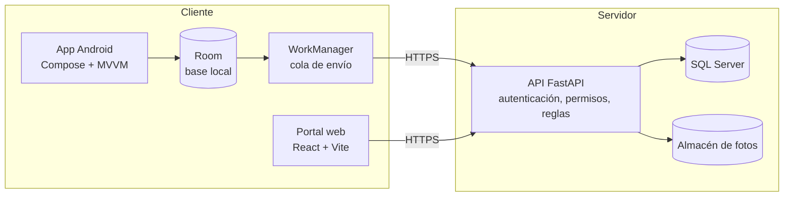
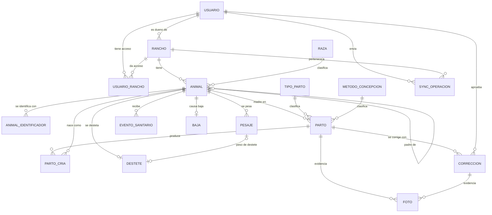
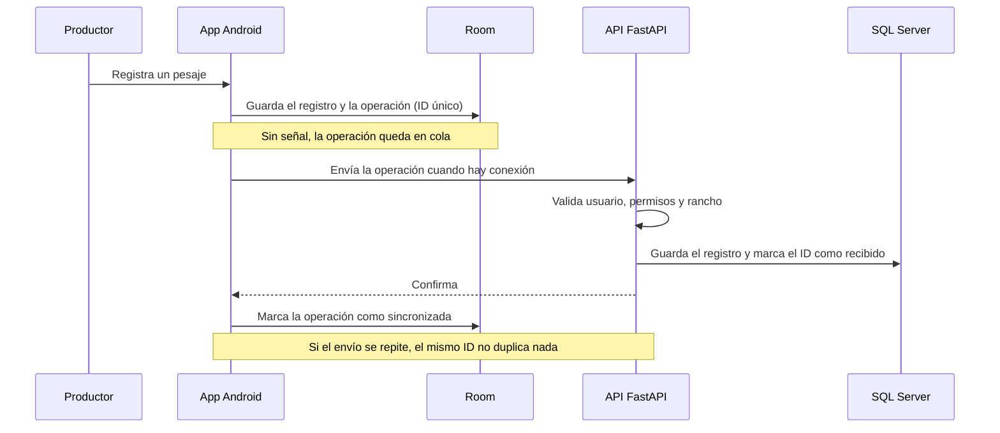
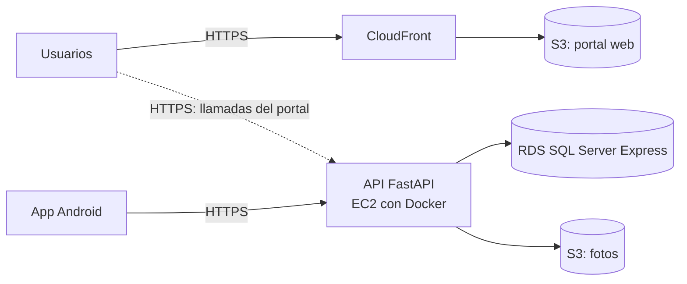

# Arquitectura de Ovium

Ovium es una app Android y un portal web para gestionar ranchos de ovinos en Jalisco, México. El prototipo se entrega el **29 de noviembre de 2026** y se enfoca en dos cosas: **registro de datos** (nacimientos, pesajes, bajas) y **base de datos**. Todo lo demás queda para la Fase 2.

Este documento describe las tecnologías, los subsistemas, el modelo de datos y el despliegue. Lo marcado como **por confirmar** todavía no está decidido o no está construido.

## 1. Requisitos que guían la arquitectura

| ID | Requisito no funcional | Qué decisión provoca |
|---|---|---|
| RNF-01 | Operar de forma fluida en teléfonos Android de los productores | App nativa Android con base local, minSdk 26 |
| RNF-02 | Proteger datos y respetar autorizaciones y aislamiento por rancho y usuario | Permisos validados siempre en el servidor, no en la app |
| RNF-03 | Arquitectura mantenible, que evolucione de Jalisco a México y Centroamérica | Capas separadas, migraciones versionadas, nube escalable |
| RNF-04 | Captura móvil rápida en campo y consulta cómoda desde computadora | App Android para capturar y portal web para consultar |

El campo no siempre tiene señal, por eso la app **captura sin conexión** y sincroniza después.

## 2. Tecnologías elegidas

| Parte | Tecnología | Por qué |
|---|---|---|
| App móvil | Android con Kotlin, Jetpack Compose y MVVM | Es la plataforma de los productores. Compose y MVVM separan pantalla y lógica. |
| Base local en la app | Room (SQLite) | Guarda los registros sin internet. |
| Cola de sincronización | WorkManager | Reintenta el envío cuando vuelve la señal. |
| Comunicación app-API | Retrofit sobre HTTPS | Cliente HTTP estándar de Android. |
| API | Python con FastAPI | Rápida de construir, con documentación automática de los endpoints. |
| Acceso a datos | SQLAlchemy y Alembic | SQLAlchemy mapea tablas a clases. Alembic versiona los cambios de la base. |
| Base de datos | Microsoft SQL Server, edición Express | Base relacional gratuita, con integridad por llaves y transacciones. |
| Portal web | React con Vite | Interfaz de escritorio ligera, con proyecto base rápido de levantar. |
| Entorno local | Docker Compose | Todos levantan SQL Server y la API igual en su computadora. |
| Nube | AWS | Ver sección 9. |
| Código y tareas | GitHub (organización OVIUM-team) y Trello | Pull requests con revisión y tablero por sprint. |

## 3. Subsistemas

**App Android.** Es la herramienta de captura en campo. Guarda todo primero en Room y lo manda a la API cuando hay conexión. Muestra inventario, ficha del animal, registro de nacimiento con foto y registro de pesaje.

**API (FastAPI).** Es el único punto de entrada a la base de datos. Autentica usuarios, valida permisos por rol y rancho, aplica las reglas de negocio y recibe las operaciones de sincronización.

**Base de datos (SQL Server).** Guarda 16 tablas. Las llaves primarias son UUID generados en el cliente, para poder crear registros sin conexión sin chocar con otros.

**Portal web (React).** Lo usan técnico, asociación y productor desde la computadora: login, ranchos, inventario, nacimientos y pesajes, corrección de nacimientos y descarga de la Sábana en Excel.

**Nube (AWS).** Aloja la base de datos, la API, el portal y las fotos.

## 4. Diagrama de componentes

## 5. Modelo de datos

El diagrama completo, con columnas y claves, está en el [diagrama ER de Ovium](https://claude.ai/artifact/UXKzfQVESEYohf2Q65SASm). Aquí van las relaciones.

### Roles

| Rol | Alcance |
|---|---|
| Productor | Dueño del rancho. Ve y captura solo en su rancho. |
| Rama | Subcuenta del productor, con permisos de lectura, captura, edición y exportación. |
| Técnico | Usuario independiente, ligado a varios ranchos por `usuario_rancho`. Corrige nacimientos con evidencia. |
| Asociación | Usuario de la asociación de ovinos (hay una sola). Ve todos los ranchos y puede corregir nacimientos. |

### Reglas de negocio que el modelo respeta

- Los animales **nunca se borran**: la baja se guarda en `baja`, con motivo y fecha.
- El parto se **bloquea a los 30 días** (`cierre_edicion`). Después solo se corrige con `correccion` y una foto de evidencia.
- La corrección guarda el valor anterior y el nuevo, así que el original no se pierde.
- Los **días de lactancia** son un parámetro por rancho (75 por defecto) y de ahí sale la alerta de destete.
- Folio, arete, SINIIGA y folio UNO son identificadores de negocio. La llave real es el UUID.

## 6. Sincronización sin conexión

El campo puede no tener señal. La app guarda cada operación con un **ID único** y la manda cuando hay conexión. Si el envío se repite, la API reconoce el ID y no duplica el registro (sincronización **idempotente**).

**Por confirmar con el MVZ Álvaro:** qué regla se aplica cuando dos cambios sin conexión chocan. Propuesta: gana la última modificación y se guarda el historial.

## 7. Redes y comunicación

- La app y el portal hablan con la API por **HTTPS**. Android bloquea el tráfico HTTP sin cifrar, así que en la nube es obligatorio.
- La API expone endpoints REST con datos en JSON.
- El portal web está en otro origen que la API, así que la API activa **CORS** solo para el origen del portal.
- La base de datos **no se abre a internet**: solo la API puede conectarse a ella.
- En local, la API usa el puerto 8000, el portal el 5173 y SQL Server el 1433 (los valores por defecto de cada herramienta).

## 8. Sistemas operativos

- **Teléfonos de los productores:** Android 8.0 o superior (minSdk 26).
- **Computadoras del equipo:** Windows o macOS con Docker, que corre SQL Server y la API en contenedores Linux.
- **Servidores en la nube:** contenedores Linux.
- **Usuarios del portal:** cualquier navegador moderno en cualquier sistema operativo.

## 9. Nube (AWS)

Estado: cuenta abierta con plan gratuito, con **100 USD de créditos** y 182 días de vigencia. Región elegida: **us-east-2 (Ohio)**. Todo se despliega en la misma región.

| Parte | Servicio propuesto | Estado |
|---|---|---|
| Base de datos | Amazon RDS para SQL Server Express (instancia `ovium-db`, SQL Server 2019, `db.t3.micro`, 20 GiB, sin acceso público) | Creada el 19 de noviembre de 2026 |
| API | EC2 con Docker (el mismo Docker Compose del entorno local) | Decidido el 19 de noviembre de 2026 |
| Portal web | S3 con CloudFront | Por confirmar |
| Fotos | S3 | Por confirmar |
| Acceso del equipo | AWS Team o usuarios IAM | En proceso |

La instancia de RDS cuesta unos 0.025 USD por hora (unos 18 USD al mes si queda encendida) y sale de los créditos. No tiene acceso público: solo la API, cuando corra en EC2, podrá conectarse. El SQL Server local de Docker es 2022 y el de RDS es 2019, así que el código no debe usar funciones exclusivas de 2022.

Los secretos (contraseña de la base, llave del JWT) se configuran en el servicio donde corre la API. **Nunca van en el código ni en la imagen de Docker.**

## 10. Programación orientada a objetos

El código se organiza en clases con una responsabilidad clara:

- **Entidades del dominio:** `Animal`, `Parto`, `Pesaje`, `Destete`, `Baja`, `Correccion`. Cada una guarda sus datos y sus propias reglas, por ejemplo si un parto ya está bloqueado.
- **Repositorios:** esconden de dónde vienen los datos. En Android, un repositorio decide si lee de Room o de la API. En el backend, un repositorio usa SQLAlchemy.
- **Servicios:** aplican las reglas de negocio, como la ventana de 30 días o la validación de permisos.
- **ViewModels (MVVM):** conectan los repositorios con las pantallas de Compose, y las pantallas no tocan datos directamente.
- **Encapsulamiento y bajo acoplamiento:** cada capa solo conoce a la siguiente, así se pueden cambiar piezas sin romper todo.

## 11. Fuera del prototipo (Fase 2)

Corrales y cuarentena, dietas, indicadores económicos, código QR por animal, marketplace, importación desde Excel y árbol genealógico.

## 12. Decisiones abiertas

- Regla de conflictos al sincronizar sin conexión (confirmar con el MVZ Álvaro).
- Alcance del árbol genealógico: 4 ancestros o 4 generaciones.
- Si el indicador de utilidad incluye costos.
